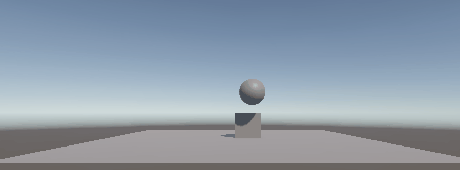
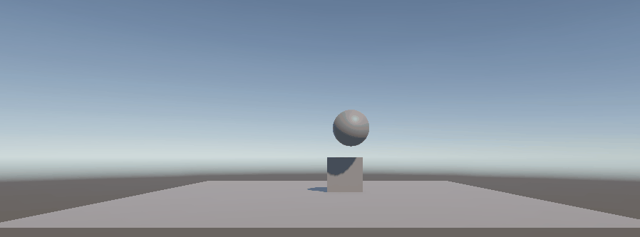
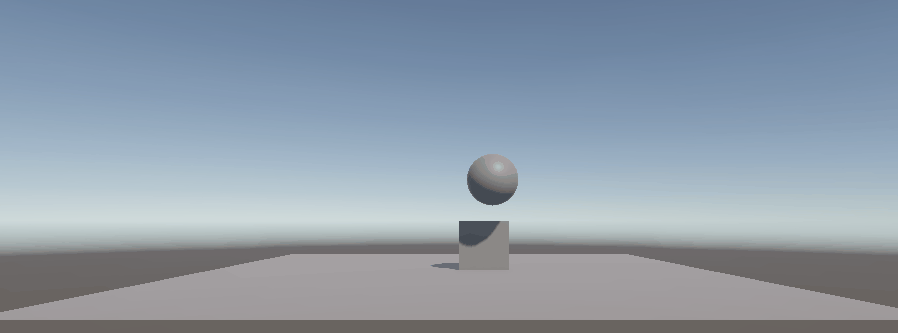
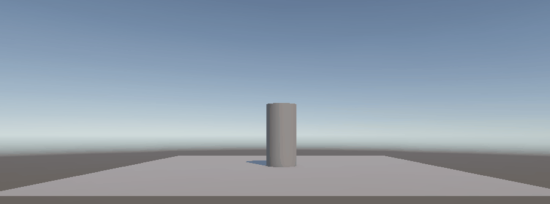
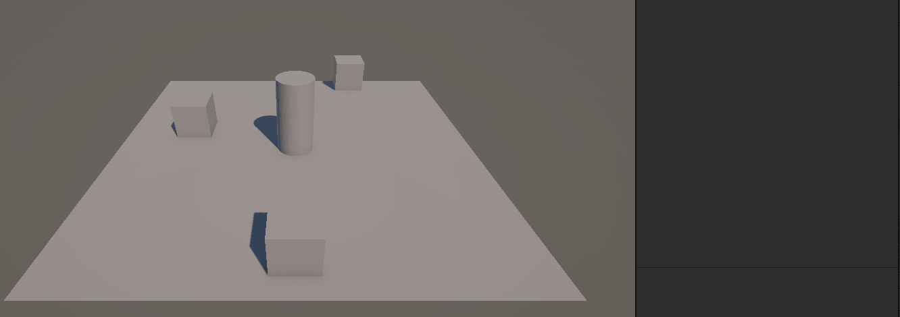
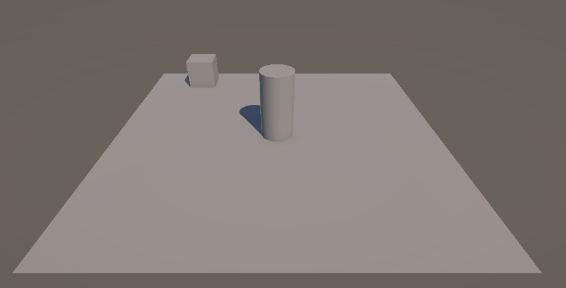

# Práctica: Introducción a Físicas 3D en Unity

**Asignatura:** Interfaces Inteligentes  
**Titulación:** Grado en Ingeniería Informática — Universidad de La Laguna (ULL)
**Autor:** Bruno Morales Hernández 

---

## 📁 Estructura de Entrega


```text
.
├── Assets/
│   ├── Scenes/
│   │   └── SampleScene.unity      # Escena principal con la batería de pruebas
│   ├── Scripts/                   # Scripts en C# desarrollados para las prácticas
│   └── Settings/                  # Configuraciones URP y perfiles de volumen
├── Gifs/                          # Capturas y animaciones demostrativas de cada situación
├── Packages/                      # Manifiesto de paquetes de Unity
├── ProjectSettings/               # Configuración del motor (Input Manager, Physics, etc.)
└── README.md                      # Documentación y justificación técnica
```

---

## Parte 1: Experimentos con Rigidbody y Colliders

En este bloque se analiza el comportamiento físico y la respuesta de colisiones al modificar las propiedades `Rigidbody` y `Collider` en una escena compuesta por un **Plano**, un **Cubo** y una **Esfera**.

---

### Situación 1
* **Configuración:**
  * **Plano:** `Collider` estático (sin `Rigidbody`).
  * **Cubo:** `Collider` + `Rigidbody` dinámico (`Use Gravity = true`, `Is Kinematic = false`). Posición inicial: $Y = 0.5$.
  * **Esfera:** `Collider` estático (sin `Rigidbody`). Posición elevada.
* **Comportamiento observado:**
  * El cubo cae afectado por la gravedad ($9.81\ \text{m/s}^2$) hasta que su `BoxCollider` hace contacto con el `MeshCollider` del plano, deteniéndose. Si parte de $Y = 0.5$, ya se encuentra apoyado sobre el plano.
  * La esfera permanece suspendida indefinidamente en el aire.
* **Justificación teórica:**
  * Un objeto sin `Rigidbody` se considera un *Static Collider*. No se ve afecto por la gravedad ni fuerzas externas.
  * El plano actúa como superficie estática inamovible frente a objetos dinámicos.
* **Demostración:**  
  

---

### Situación 2
* **Configuración:**
  * **Plano:** `Collider` estático (sin `Rigidbody`).
  * **Cubo:** `Collider` + `Rigidbody` dinámico (`Use Gravity = true`, `Is Kinematic = false`). Posición inicial: $Y = 0.5$.
  * **Esfera:** `Collider` + `Rigidbody` dinámico (`Use Gravity = true`, `Is Kinematic = false`). Posición inicial: $X = 0.64$, $Y = 1.79$, $Z = -0.36$.
* **Comportamiento observado:**
  * La esfera ahora se ve afectada por la gravedad y fuerzas externas, por lo que cae desde una altura y choca con el cubo.
  * El cubo, al recibir el choque con la esfera, tiene un breve tambaleo (muy poco, apenas apreciable).
  * La esfera sigue rodando sobre el plano, hasta que lo atraviesa por completo y cae al vacío.
* **Justificación teórica:**
  * Tanto la esfera como el cubo son ***Dynamic Colliders*** (`Rigidbody Collider`): ambos se ven afectados por la gravedad y fuerzas externas. De aquí sale el pequeño tambaleo del cubo.
  * El plano actúa como superficie estática (*Static Collider*) inamovible frente a objetos dinámicos.
* **Demostración:**  
  

---

### Situación 3
* **Configuración:**
  * **Plano:** `Collider` estático (sin `Rigidbody`).
  * **Cubo:** `Collider` + `Rigidbody` dinámico (`Use Gravity = true`, `Is Kinematic = false`). Posición inicial: $Y = 0.5$.
  * **Esfera:** `Collider` + `Rigidbody` cinemático (`Use Gravity = true`, `Is Kinematic = true`). Posición inicial: $X = 0.64$, $Y = 1.79$, $Z = -0.36$.
* **Comportamiento observado:**
  * La esfera vuelve a ignorar la gravedad y fuerzas externas, por lo que se mantiene suspendida en el aire. Solo se podria mover usando un script.
  * Al no caer la esfera, no se produce ninguna interacción con el cubo y se mantiene estático.
  * No hay ningun movimiento visible en la escena.
* **Justificación teórica:**
  * La esfera pasa a ser un ***Kinematic Rigidbody Collider***. No se ve afectado por fuerzas externas y como no tiene script para su movimiento se mantiene estático.
  * El cubo es un *Dynamic Collider*. No tiene movimiento ya esta apoyado en el plano y ningun objeto lo toca
  * El plano actúa como superficie estática (*Static Collider*) inamovible frente a objetos dinámicos.
* **Demostración:**  
  

---

### Situación 4
- **Configuración:**
  * **Plano:** `Collider` + `Rigidbody` dinámico (`Use Gravity = true`, `Is Kinematic = false`).
  * **Cubo:** `Collider` + `Rigidbody` dinámico (`Use Gravity = true`, `Is Kinematic = false`). Posición inicial: $Y = 0.5$.
  * **Esfera:** `Collider` + `Rigidbody` dinámico (`Use Gravity = true`, `Is Kinematic = false`). Posición inicial: $X = 0.64$, $Y = 1.79$, $Z = -0.36$.
- **Comportamiento observado:**
  * Todos los objetos en la escena son *Dynamic Collider* que se ven afectados por la gravedad.
  * Al no tener un punto de apoyo, todos los objetos caen al vacío y desaparecen de la escena.
- **Justificación teórica:**
  * Tanto la esfera como el cubo como el plano son *Dynamic Collider*. Se ven afectados por la gravedad y fuerzas externas.
  * No hay ningún *Static Collider* que los detenga, por lo que caen al vacío.
- **Demostración:**  
  

---

### Situación 5
* **Configuración:**
  * **Plano:** `Collider` + `Rigidbody` cinemático (`Is Kinematic = true`).
  * **Cubo:** `Collider` + `Rigidbody` dinámico (`Use Gravity = true`, `Is Kinematic = false`, `Mass = 1`). Posición inicial: $Y = 0.5$.
  * **Esfera:** `Collider` + `Rigidbody` dinámico (`Use Gravity = true`, `Is Kinematic = false`, `Mass = 10`). Posición inicial: $X = 0.64$, $Y = 1.79$, $Z = -0.36$.
* **Comportamiento observado:**
  * El plano ya no cae al vacío y se mantiene estático sirviendo de soporte para el resto de objetos.
  * El cubo se apoya en el plano y la esfera cae afectada por la gravedad.
  * Al impactar la esfera contra el cubo, como tiene 10 veces más masa, el desplazamiento del cubo es mucho más notorio que en la situación 2, saliendo despedido con mayor fuerza antes de que la esfera ruede y caiga del plano.
* **Justificación teórica:**
  * El plano es un ***Kinematic Rigidbody Collider***: no se ve afectado por la gravedad ni por fuerzas externas, por lo que actúa como un soporte fijo frente a los choques sin caerse.
  * Tanto la esfera como el cubo son ***Dynamic Colliders*** (`Rigidbody Collider`) y responden a la gravedad e impactos.
  * Al tener la esfera 10 veces más masa que el cubo, en el choque transmite mucha más fuerza, provocando que el cubo sufra un empuje bastante mayor.
* **Demostración:**  
  

---

### Situación 6
* **Configuración:**
  * **Plano:** `Collider` + `Rigidbody` cinemático (`Is Kinematic = true`).
  * **Cubo:** `Collider` + `Rigidbody` dinámico (`Use Gravity = true`, `Is Kinematic = false`, `Mass = 1`). Posición inicial: $Y = 0.5$.
  * **Esfera:** `Collider` + `Rigidbody` dinámico (`Use Gravity = true`, `Is Kinematic = false`, `Mass = 100`). Posición inicial: $X = 0.64$, $Y = 1.79$, $Z = -0.36$.
* **Comportamiento observado:**
  * El plano se mantiene inmóvil en su posición actuando como suelo.
  * La esfera cae por gravedad e impacta contra el cubo con mucha más contundencia que en los casos anteriores.
  * El impacto provoca un desplazamiento notablemente mayor en el cubo, saliendo despedido con gran fuerza.
  * La esfera tarda más tiempo en deslizarse sobre el plano hasta llegar al borde y caer.
* **Justificación teórica:**
  * El plano es un ***Kinematic Rigidbody Collider***: no se ve afectado por la gravedad ni por fuerzas externas, manteniéndose firme frente a los choques.
  * La esfera y el cubo son ***Dynamic Colliders*** (`Rigidbody Collider`) que reaccionan a la gravedad y a las fuerzas generadas por la colisión.
  * Al tener la esfera 100 veces más masa que el cubo, la transferencia de fuerza durante el impacto es mucho mayor, desplazando al cubo con extrema facilidad. A su vez, el gran aumento de masa genera una inercia mucho mayor al interactuar con la superficie del plano.
* **Demostración:**  
  

---

### Situación 7
* **Configuración:**
  * **Plano:** `Collider` + `Rigidbody` dinámico (`Use Gravity = true`, `Is Kinematic = false`).
  * **Cubo:** `Collider` + `Rigidbody` dinámico (`Use Gravity = true`, `Is Kinematic = false`). Posición inicial: $Y = 0.5$.
  * **Esfera:** `Collider` (con `Physic Material` de fricción) + `Rigidbody` dinámico (`Use Gravity = true`, `Is Kinematic = false`). Posición inicial: $X = 0.64$, $Y = 1.79$, $Z = -0.36$.
* **Comportamiento observado:**
  * Al igual que en la situación 4, todos los objetos de la escena caen al vacío sin ningún control por efecto de la gravedad.
  * La fricción configurada en la esfera no llega a apreciarse, ya que el plano también cae y no llega a existir una superficie firme sobre la que rodar o frenarse.
  * Desde el encuadre de la cámara únicamente se aprecia el inicio de la caída conjunta de los tres objetos antes de desaparecer.
* **Justificación teórica:**
  * Todos los objetos de la escena actúan como ***Dynamic Colliders*** (`Rigidbody Collider`), viéndose afectados por la gravedad y fuerzas externas sin restricciones.
  * Al no contar con ningún ***Static Collider*** que actúe como suelo fijo, la escena entera cae al vacío.
  * El `Physic Material` de fricción solo tiene efecto cuando hay contacto continuo y deslizamiento entre dos superficies con fuerza normal; al estar el plano cayendo a la par, el rozamiento no produce ningún efecto visible.
* **Demostración:**  
  

---

### Situación 8
* **Configuración:**
  * **Plano:** `Collider` + `Rigidbody` cinemático (`Is Kinematic = true`).
  * **Cubo:** `Collider` + `Rigidbody` dinámico (`Use Gravity = true`, `Is Kinematic = false`). Posición inicial: $Y = 0.5$.
  * **Esfera:** `SphereCollider` configurado como Trigger (`Is Trigger = true`), sin `Rigidbody`. Posición inicial: $X = 0.64$, $Y = 1.79$, $Z = -0.36$.
* **Comportamiento observado:**
  * La esfera permanece suspendida en el aire en su posición inicial sin experimentar caída alguna.
  * El plano se mantiene inmóvil en su sitio y sirve de apoyo para el cubo.
  * El cubo se mantiene estático sobre el plano sin sufrir alteraciones al no haber interacción física con la esfera.
* **Justificación teórica:**
  * Al no tener `Rigidbody`, la esfera actúa como un colisionador estático (*Static Trigger Collider*), por lo que la gravedad y las fuerzas no le afectan y permanece inmóvil.
  * Al estar configurada como Trigger, pierde la respuesta física sólida y solo sirve para detectar traspasos de otros objetos mediante eventos de código (`OnTriggerEnter`), no para generar colisiones con rebote.
  * El plano es un ***Kinematic Rigidbody Collider***, por lo que no cae por gravedad y sostiene al cubo dinámico.
* **Demostración:**  
  

---

### Situación 9
* **Configuración:**
  * **Plano:** `Collider` + `Rigidbody` cinemático (`Is Kinematic = true`).
  * **Cubo:** `Collider` + `Rigidbody` dinámico (`Use Gravity = true`, `Is Kinematic = false`). Posición inicial: $Y = 0.5$.
  * **Esfera:** `SphereCollider` con Trigger activo (`Is Trigger = true`) + `Rigidbody` dinámico (`Use Gravity = true`, `Is Kinematic = false`). Posición inicial: $X = 0.64$, $Y = 1.79$, $Z = -0.36$.
* **Comportamiento observado:**
  * La esfera vuelve a verse afectada por la gravedad y cae desde su posición inicial.
  * Al tener el trigger activado, atraviesa limpiamente tanto el cubo como el plano sin chocar ni empujarlos, continuando su caída indefinidamente hacia el vacío.
  * El cubo se mantiene en su sitio sobre el plano sin inmutarse cuando la esfera pasa a través de él.
* **Justificación teórica:**
  * La esfera es un ***Dynamic Trigger Collider*** (`Rigidbody` dinámico con `Is Trigger = true`): responde a la gravedad, pero su colisionador no genera respuestas físicas de contacto (fuerzas de contacto o rebote).
  * Los triggers están diseñados únicamente para detectar traspasos e interactuar mediante código con eventos de tipo `OnTriggerEnter`, por lo que atraviesa cualquier superficie sólida sin detenerse ni desplazar a los otros objetos.
* **Demostración:**  
  

---

## Parte 2: Control de movimiento y scripts con Rigidbody

### Ejercicio 1: Movimiento del personaje con control total
* **Configuración:**
  * **Objeto Personaje:** Cilindro con componente `Collider` y `Rigidbody` dinámico (`Use Gravity = true`, `Is Kinematic = false`).
  * **Script `MoverPersonaje`:**
    * Variable pública `speed` para modificar la velocidad cómodamente desde el Inspector.
    * Referencia privada al componente `Rigidbody` obtenida en `Start()` mediante `GetComponent<Rigidbody>()`.
    * Variables intermediarias para almacenar los valores de los ejes horizontal y vertical entre el `Update()` y el `FixedUpdate()`.
* **Comportamiento observado:**
  * El personaje responde de forma inmediata a la pulsación de las teclas WASD o las flechas de dirección.
  * Al soltar las teclas, el personaje se detiene en seco sin deslizarse ni patinar por inercia, manteniendo en todo momento una trayectoria controlada y sin volcar.
* **Justificación teórica:**
  * La lectura de las entradas del teclado se realiza en el método `Update()`, ya que está sincronizado con la tasa de refresco visual por frame. Se emplea `Input.GetAxisRaw()` para obtener una respuesta inmediata (valores puros $0$ o $1$) y eliminar el suavizado progresivo.
  * Los cálculos y la aplicación del desplazamiento se ejecutan estrictamente dentro de `FixedUpdate()`, ya que es el método dedicado a la actualización del motor de física a intervalos de tiempo constantes (`Time.fixedDeltaTime`).
  * En lugar de alterar el `Transform` directamente (lo que rompería la simulación de colisiones), se utiliza `rb.MovePosition()`, garantizando que el cuerpo físico se mueva respetando los choques con el entorno y manteniendo el control total sobre la velocidad del objeto.
* **Demostración:**  
  

---

### Ejercicio 2: Detección de colisiones y cambio de color

* **Configuración:**
  * **Cubos de la escena:** Primitivas 3D configuradas con `BoxCollider` y `Rigidbody` dinámico (`Use Gravity = true`, `Is Kinematic = false`).
  * **Script `ColisionCubos`:**
    * Referencias privadas a los componentes `Rigidbody` y `Renderer` para gestionar la física y la apariencia visual.
    * Variable booleana `colision` inicializada en `false` para controlar el estado y registrar si el cubo ya ha recibido un impacto previo.
    * Inicialización en el método `Start()` mediante `GetComponent<Rigidbody>()` y `GetComponent<Renderer>()` para cachear los componentes desde el arranque.

* **Comportamiento observado:**
  * Al avanzar con el personaje e impactar contra los cubos, la fuerza del choque desplaza físicamente los cubos por el plano.
  * En el instante de la colisión, el cubo impactado cambia inmediatamente su color a rojo y muestra por consola el mensaje indicando el objeto contra el que ha chocado.
  * Debido a que el personaje cuenta con un `Rigidbody` dinámico, no tiene restricciones de rotación en sus ejes (`Freeze Rotation` desmarcado) ni materiales de fricción específicos, tras el impacto se desestabiliza fácilmente, volcando y rodando sobre la superficie del suelo.

* **Justificación teórica:**
  * **Arquitectura por eventos:** No es necesario comprobar distancias ni consultar estados continuamente dentro de `Update()` o `FixedUpdate()`. La interacción se delega por completo en el evento `OnCollisionEnter(Collision collision)`, el cual es invocado de forma automática por el motor de físicas en el milisegundo exacto del contacto entre dos cuerpos rígidos.
  * **Filtrado de colisiones:** Es imprescindible discriminar qué objeto provoca el evento para evitar falsos positivos. Al arrancar la escena, la gravedad hace caer al cubo sobre el suelo (`Plane`); filtrando por el nombre o etiqueta del jugador se evita que el cubo cambie de color nada más empezar por tocar el piso.
  * **Modificación visual:** Una vez validado el contacto con el personaje, se accede al material a través de la propiedad `render.material.color` y se actualiza el valor del booleano para bloquear cambios posteriores.
  * **Dinámica física sin restricciones:** El hecho de que el cilindro ruede por el escenario tras chocar demuestra el comportamiento físico real por defecto de Unity: al no ser un objeto cinemático ni tener congelados los giros angulares, cualquier fuerza tangencial sobre su superficie curva genera un momento de inercia que lo hace rodar indefinidamente.

* **Demostración:**

  

---

### Ejercicio 3: Zonas de detección con Trigger y emisión de luz

* **Configuración:**
  * **Cubo (Zona Trigger):** Objeto cubo con su componente `BoxCollider`. No necesita tener un componente `Rigidbody`, únicamente se marca la casilla `Is Trigger` en el Inspector. Dado que el personaje ya cuenta con `Rigidbody`, el motor detecta la interacción sin problema.
  * **Material del Cubo:** Configurado con la propiedad de emisión activada en el Inspector para poder iluminarlo mediante script.
  * **Script `OnTriggerCubo`:**
    * Variable pública `brillo` de tipo float para ajustar la intensidad de la luz desde el Inspector.
    * Referencia privada al componente `Renderer` del cubo.
    * En el método `Start()`, se obtiene el componente con `GetComponent<Renderer>()` y se activa la palabra clave `_EMISSION` en el material para permitir la modificación de luz en tiempo de ejecución.

* **Comportamiento observado:**
  * Al mover al personaje hacia el cubo, este no choca físicamente ni frena el avance, sino que lo atraviesa sin resistencia.
  * En el momento en que el personaje entra en el volumen del cubo, este se ilumina emitiendo un brillo de color amarillo, mientras que el personaje cambia su color a azul.
  * Al salir de la zona del cubo, el brillo del cubo se apaga por completo y el personaje vuelve a su color gris original.

* **Justificación teórica:**
  * **Colisión sólida vs Trigger:** Al activar `Is Trigger`, el objeto pierde sus propiedades de colisión física (no calcula fuerzas ni rebotes) y pasa a comportarse como un sensor de volumen. Como el personaje ya posee un `Rigidbody` dinámico, no es necesario añadirle otro al cubo para disparar los eventos de paso.
  * **Detección por eventos:** La lógica no depende de bucles en `Update()`. Se gestiona mediante dos métodos automáticos del motor de físicas:
    * `OnTriggerEnter(Collider other)`: Se ejecuta en el instante en que un cuerpo entra en el área. Se comprueba que el objeto entrante sea el jugador antes de encender la emisión (`_EmissionColor`) y pintar al personaje.
    * `OnTriggerExit(Collider other)`: Se ejecuta justo cuando el cuerpo abandona el volumen, restableciendo el color del jugador y apagando la emisión del material (poniendo el color en negro y el brillo a cero).

* **Demostración:**  
  