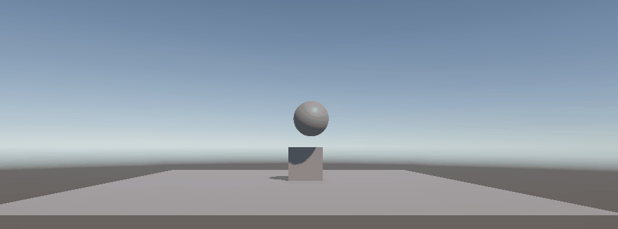
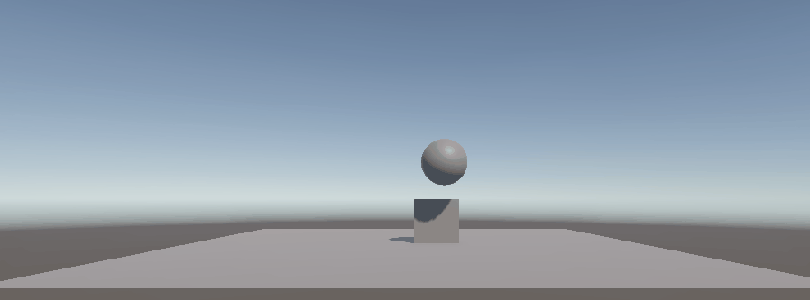
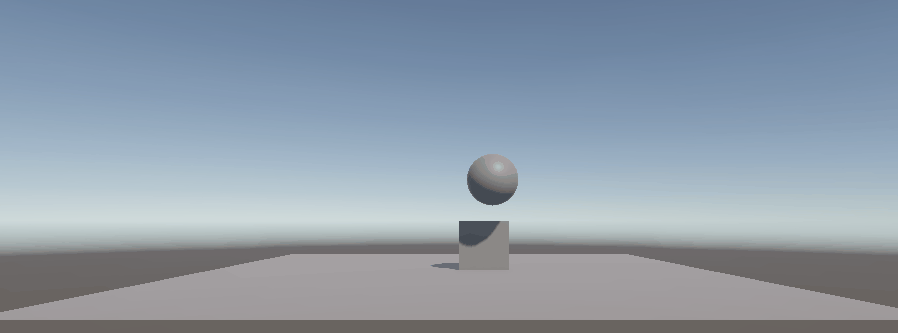
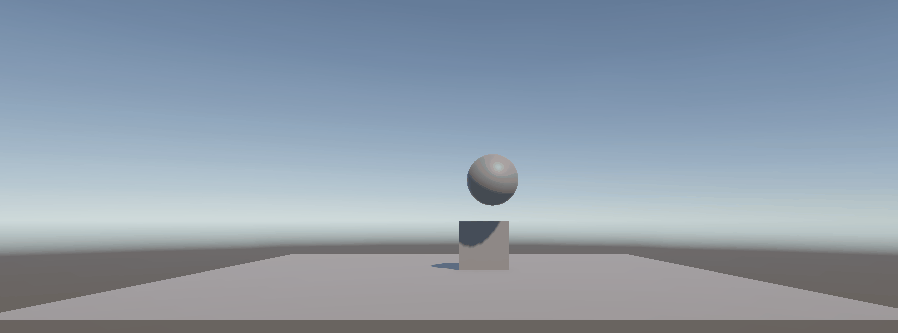

# Práctica: Introducción a Físicas 3D en Unity

**Asignatura:** Interfaces Inteligentes  
**Titulación:** Grado en Ingeniería Informática — Universidad de La Laguna (ULL)
**Autor:** Bruno Morales Hernández 

---

## 📁 Estructura de Entrega


```text
.
├── Assets/
│   ├── Scenes/
│   │   └── SampleScene.unity      # Escena principal con la batería de pruebas
│   ├── Scripts/                   # Scripts en C# desarrollados para las prácticas
│   └── Settings/                  # Configuraciones URP y perfiles de volumen
├── Gifs/                          # Capturas y animaciones demostrativas de cada situación
├── Packages/                      # Manifiesto de paquetes de Unity
├── ProjectSettings/               # Configuración del motor (Input Manager, Physics, etc.)
└── README.md                      # Documentación y justificación técnica
```

---

## Parte 1: Experimentos con Rigidbody y Colliders

En este bloque se analiza el comportamiento físico y la respuesta de colisiones al modificar las propiedades `Rigidbody` y `Collider` en una escena compuesta por un **Plano**, un **Cubo** y una **Esfera**.

---

### Situación 1
* **Configuración:**
  * **Plano:** `Collider` estático (sin `Rigidbody`).
  * **Cubo:** `Collider` + `Rigidbody` dinámico (`Use Gravity = true`, `Is Kinematic = false`). Posición inicial: $Y = 0.5$.
  * **Esfera:** `Collider` estático (sin `Rigidbody`). Posición elevada.
* **Comportamiento observado:**
  * El cubo cae afectado por la gravedad ($9.81\ \text{m/s}^2$) hasta que su `BoxCollider` hace contacto con el `MeshCollider` del plano, deteniéndose. Si parte de $Y = 0.5$, ya se encuentra apoyado sobre el plano.
  * La esfera permanece suspendida indefinidamente en el aire.
* **Justificación teórica:**
  * Un objeto sin `Rigidbody` se considera un *Static Collider*. No se ve afecto por la gravedad ni fuerzas externas.
  * El plano actúa como superficie estática inamovible frente a objetos dinámicos.
* **Demostración:**  
  

---

### Situación 2
* **Configuración:**
  * **Plano:** `Collider` estático (sin `Rigidbody`).
  * **Cubo:** `Collider` + `Rigidbody` dinámico (`Use Gravity = true`, `Is Kinematic = false`). Posición inicial: $Y = 0.5$.
  * **Esfera:** `Collider` + `Rigidbody` dinámico (`Use Gravity = true`, `Is Kinematic = false`). Posición inicial: $X = 0.64$, $Y = 1.79$, $Z = -0.36$.
* **Comportamiento observado:**
  * La esfera ahora se ve afectada por la gravedad y fuerzas externas, por lo que cae desde una altura y choca con el cubo.
  * El cubo, al recibir el choque con la esfera, tiene un breve tambaleo (muy poco, apenas apreciable).
  * La esfera sigue rodando sobre el plano, hasta que lo atraviesa por completo y cae al vacío.
* **Justificación teórica:**
  * Tanto la esfera como el cubo son ***Dynamic Colliders*** (`Rigidbody Collider`): ambos se ven afectados por la gravedad y fuerzas externas. De aquí sale el pequeño tambaleo del cubo.
  * El plano actúa como superficie estática (*Static Collider*) inamovible frente a objetos dinámicos.
* **Demostración:**  
  

---

### Situación 3
* **Configuración:**
  * **Plano:** `Collider` estático (sin `Rigidbody`).
  * **Cubo:** `Collider` + `Rigidbody` dinámico (`Use Gravity = true`, `Is Kinematic = false`). Posición inicial: $Y = 0.5$.
  * **Esfera:** `Collider` + `Rigidbody` cinemático (`Use Gravity = true`, `Is Kinematic = true`). Posición inicial: $X = 0.64$, $Y = 1.79$, $Z = -0.36$.
* **Comportamiento observado:**
  * La esfera vuelve a ignorar la gravedad y fuerzas externas, por lo que se mantiene suspendida en el aire. Solo se podria mover usando un script.
  * Al no caer la esfera, no se produce ninguna interacción con el cubo y se mantiene estático.
  * No hay ningun movimiento visible en la escena.
* **Justificación teórica:**
  * La esfera pasa a ser un ***Kinematic Rigidbody Collider***. No se ve afectado por fuerzas externas y como no tiene script para su movimiento se mantiene estático.
  * El cubo es un *Dynamic Collider*. No tiene movimiento ya esta apoyado en el plano y ningun objeto lo toca
  * El plano actúa como superficie estática (*Static Collider*) inamovible frente a objetos dinámicos.
* **Demostración:**  
  

---

### Situación 4
- **Configuración:**
  * **Plano:** `Collider` + `Rigidbody` dinámico (`Use Gravity = true`, `Is Kinematic = false`).
  * **Cubo:** `Collider` + `Rigidbody` dinámico (`Use Gravity = true`, `Is Kinematic = false`). Posición inicial: $Y = 0.5$.
  * **Esfera:** `Collider` + `Rigidbody` dinámico (`Use Gravity = true`, `Is Kinematic = false`). Posición inicial: $X = 0.64$, $Y = 1.79$, $Z = -0.36$.
- **Comportamiento observado:**
  * Todos los objetos en la escena son *Dynamic Collider* que se ven afectados por la gravedad.
  * Al no tener un punto de apoyo, todos los objetos caen al vacío y desaparecen de la escena.
- **Justificación teórica:**
  * Tanto la esfera como el cubo como el plano son *Dynamic Collider*. Se ven afectados por la gravedad y fuerzas externas.
  * No hay ningún *Static Collider* que los detenga, por lo que caen al vacío.
- **Demostración:**  
  

---